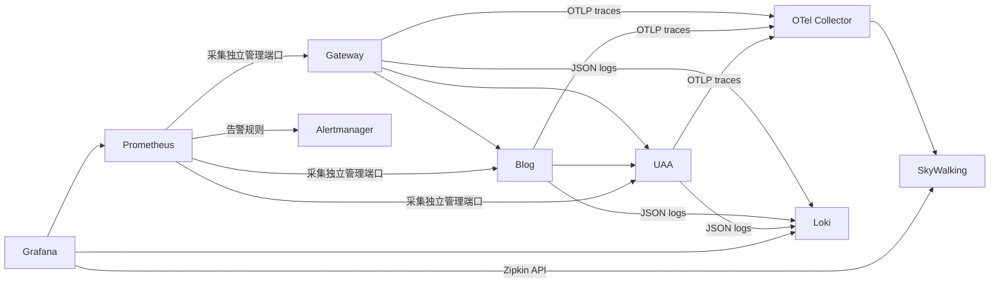

# WSL 本地集群

这里统一维护 WSL `Ubuntu-24.04` 中 `base`、`kube-system`、`life-deals`、`kumatts` 的启动来源。
清单以 2026-11-11 的实际配置为准，保留现有镜像版本、Service 名称、NodePort、PVC 模板和 Secret 引用。
`server` 目录独立维护，不从服务器清单推导本地配置。

```text
local/
├── base/               # base 命名空间：数据库、中间件、监控、链路追踪和仪表盘
├── kube-system/        # kube-system 命名空间：Strimzi 安装与 k3s 内置组件 YAML 参考副本
├── life-deals/         # 青龙、RSSHub、独立 Redis、任务初始化与访问入口
├── kumatts/            # AstrBot、语音服务、Containerfile、GPU 与本地镜像工具
├── k3s-config.yaml     # k3s 服务配置，安装到 /etc/rancher/k3s/config.yaml
└── kustomization.yaml  # Kubernetes 资源总入口
```

## 启动与更新

在 WSL 中执行，需要 Python 3、PyYAML（Ubuntu 的 `python3-yaml`）、kubectl 和现有 k3s。
`k3s-config.yaml` 不是 Kubernetes 对象，不要 `kubectl apply -f`。
它记录启用内置 Traefik 和 ServiceLB 的设置；新建集群时将该设置合并进 k3s 配置。
若旧配置中禁用了 `traefik`，先移除该禁用项并重启 k3s。日常修改 HelmChartConfig 无需重启 k3s。

```bash
cd /mnt/d/KumaProject/KumaFramework
# 解析当前地址，检查所需 Secret/StorageClass，并执行服务端 dry-run；不会更新集群。
python3 scripts/deploy-local-wsl.py
# 只查看最终清单。
python3 scripts/deploy-local-wsl.py --render
# 仅检查一个命名空间，不会部署其他命名空间。
python3 scripts/deploy-local-wsl.py --namespace life-deals
python3 scripts/deploy-local-wsl.py --namespace kumatts
# 仅部署选定命名空间；可以重复 --namespace。
python3 scripts/deploy-local-wsl.py --namespace life-deals --apply
# 明确部署：先安装 Strimzi，等待 CRD 和 Operator，再部署其余组件并等待就绪。
python3 scripts/deploy-local-wsl.py --apply
```

脚本在渲染时刷新 Kafka 的 `advertisedHost` 和本地主机指标 EndpointSlice 地址。
也可用 `--node-ip`、`--windows-host` 指定地址。默认 Windows 地址来自 WSL NAT 默认网关；
镜像网络等其他模式请显式传入能从 Pod 访问的主机地址。
直接 `kubectl apply -k k8s/local` 不会刷新这些环境地址，也不会等待 Kafka CRD 安装完成。

选择 `base` 时会先处理其 Strimzi 安装依赖；只选择 `life-deals` 或 `kumatts` 时不会部署 Kafka、
其他命名空间或修改 k3s 配置。脚本会检查必需的 hostPath、RuntimeClass 以及 `imagePullPolicy: Never`
对应的本地镜像；缺少时先按命名空间文档准备环境。
通用入口只部署 Kubernetes 资源，不安装 systemd 转发、不初始化青龙任务、不构建镜像。
这些命名空间专属操作通过各目录中的脚本显式执行。

## 命名空间与原项目的边界

| 命名空间 | 集中的部署内容 | 保留原处的应用与数据 | 专用说明 |
|---|---|---|---|
| base | 中间件、监控、链路追踪、Secret 示例、本地指标入口 | WSL 的现有 PVC 和 Secret | [监控说明](#monitoring) |
| kube-system | Strimzi HelmChart、Traefik 配置、k3s 内置启动清单参考 | k3s 自动生成的控制器和证书 | 本文下方说明 |
| life-deals | 3 个工作负载、2 个 PVC、3 个 Service、端口转发、RSS 初始化文件和管理脚本 | `D:\Vscode_project\life` 的 Faker/QingLong/RSSHub 源码，以及现有青龙和 Redis 数据卷 | [life-deals](life-deals/README.md) |
| kumatts | 2 个工作负载、构建文件、GPU 安装、镜像导入与迁移脚本 | `D:\KumaProject\KumaTTS` 源码、Python 环境、模型、AstrBot data 和语音任务目录 | [kumatts](kumatts/README.md) |

旧项目部署路径中的脚本保留为兼容转发入口，统一调用此目录；不再生成 `kumatts.json`
或维护旧的 `life-deals.yaml`。默认根目录可用 `KUMA_K8S_ROOT` 覆盖：Windows 入口使用 Windows 路径，
WSL 入口使用 `/mnt/...` 路径。

## 密钥与数据前置条件

现有集群复用已有 Secret。`base/secrets.example.yaml` 仅列出名称和键，占位值不参与 Kustomize，
不能直接用于生产数据。新环境应在仓库外准备真实 Secret，再部署；不要覆盖现有数据库密码、
Redis ACL 或 n8n encryption-key。部署脚本只检查所需 Secret 与键，不输出密钥。
Strimzi 的 CA、服务端证书及用户证书由 Operator 管理，不从运行时复制。

新环境先运行 `kubectl apply -f k8s/local/base/namespace.yaml`，在仓库外填写并创建所需 Secret，
再执行部署脚本。现有集群不要重新应用占位 Secret 示例。

这套 YAML 启动服务，不是数据库备份。n8n 的 PostgreSQL 数据库、Nacos 的 MySQL 数据库和表、
应用账户及授权需要现有持久卷或单独的数据初始化/恢复；仓库不包含现有业务数据。
StatefulSet 的 PVC 模板保留原名称和容量，不导出绑定到特定 PV 的运行时 PVC 对象。
n8n 保留现场配置中的主机目录和代理地址，迁移机器时需核对 `base/n8n.yaml` 中的 hostPath、代理及 SSH 地址。

## 每个运行 Pod 的来源

| 命名空间 | 工作负载 | 启动来源 |
|---|---|---|
| base | mysql、redis、postgresql、nacos、qdrant、n8n | `base/<名称>.yaml` 的 StatefulSet |
| base | kafka-pool-*、kafka-entity-operator | `base/kafka.yaml` 的 Kafka/KafkaNodePool，由 Strimzi 创建 |
| base | strimzi-cluster-operator | `kube-system/strimzi-helmchart.yaml` 的 HelmChart，目标命名空间为 base |
| base | otel-collector、skywalking-oap、skywalking-storage、skywalking-ui | `base/otel-collector.yaml`、`base/skywalking-*.yaml` |
| base | grafana、prometheus、loki、alertmanager | `base/<名称>.yaml`，由 `base/kustomization.yaml` 加载 |
| kube-system | coredns | k3s 内置 `kube-system/coredns.yaml` |
| kube-system | local-path-provisioner | k3s 内置 `kube-system/local-path-provisioner.yaml` |
| kube-system | metrics-server | `kube-system/metrics-server.yaml`，包含 Deployment、Service、APIService 和 RBAC |
| kube-system | traefik、svclb-traefik-* | k3s 内置 `kube-system/traefik-helmchart.yaml`，由 `kube-system/traefik-helmchart-config.yaml` 定制 |
| kube-system | 7 个 svclb-*-external-* | `base` 中相应 LoadBalancer Service，由 k3s ServiceLB 自动创建 |
| life-deals | qinglong、redis、rsshub | `life-deals/<名称>.yaml`，PVC 与相应工作负载同文件 |
| kumatts | astrbot、voice | `kumatts/astrbot.yaml`、`kumatts/voice.yaml`，使用现有主机目录 |

Traefik 默认启用，开放 HTTP 80 和 HTTPS 443；本地不配置公网 ACME 自动签证或强制 HTTPS 跳转。
业务域名和路由仍需对应 Ingress；没有匹配路由时返回 404 属于正常行为。
SkyWalking 独立 UI 默认运行 1 个副本，通过 `http://localhost:12880` 访问。`blog-local` 已移除。
不维护生成的 Pod、ReplicaSet、安装 Job、Strimzi 子资源和 ServiceLB DaemonSet 的独立 YAML，
这些资源由上表中的控制器生成。它们的生成名称、UID 和状态不属于启动配置。

## k3s 内置组件

`kube-system/` 中除 `strimzi-helmchart.yaml`、`traefik-helmchart-config.yaml` 和 Kustomize 入口外的 YAML，保存当前 **v1.36.2+k3s1** 的内置启动文件，含 Deployment、Service、
ConfigMap、ServiceAccount、RBAC、StorageClass、APIService 等依赖，便于查看与核对。
它们由 k3s 自动部署和升级，不应把这些副本加入日常 apply，以免与 k3s 重复管理。
版本升级后应同步这些参考文件。系统自动生成的认证 ConfigMap、控制器 ServiceAccount、
Root CA、Lease 和 AddOn 状态由 k3s/Kubernetes 自行维护。
`kube-system/runtime-classes.yaml` 记录 k3s 生成的 RuntimeClass；KumaTTS 的 voice 使用其中的 `nvidia`，
实际可用性依赖主机已安装 NVIDIA Container Toolkit。

依据：[k3s 内置组件管理](https://docs.k3s.io/installation/packaged-components)、
[k3s Helm 管理](https://docs.k3s.io/helm/)。


<a id="monitoring"></a>

## WSL 本地监控

部署 Loki、Grafana、Prometheus 和 Alertmanager，命名空间为 `base`。
本目录用于本地 K3s，现有远程部署流水线只应用 `k8s/server` 下的服务器配置。

本地已移除 `blog-local` Service、EndpointSlice 和 Prometheus 的 Blog 采集任务。
本地启动脚本默认只注册 UAA、Gateway、Reference 的指标入口，避免重新创建 `blog-local`。
下文三服务面板中的 Blog 历史数据仍可查询；本地不再持续采集 Blog 指标，服务器配置不受影响。

本地 `grafana.yaml` 设置 `GF_SECURITY_ALLOW_EMBEDDING=true`，允许 Console 的「公共面板」嵌入 Grafana。仍需使用现有账号登录；未启用匿名访问。服务器配置独立维护。

固定版本：Loki 3.7.8、Grafana 13.2.3、Prometheus 3.15.0、Alertmanager 0.34.1。

### 部署

```powershell
wsl -d Ubuntu-24.04 -u root -- bash /mnt/d/KumaProject/KumaFramework/scripts/deploy-monitoring-wsl.sh
wsl -d Ubuntu-24.04 -u root -- bash /mnt/d/KumaProject/KumaFramework/scripts/expose-monitoring-wsl.sh
wsl -d Ubuntu-24.04 -u root -- python3 /mnt/d/KumaProject/KumaFramework/scripts/check-monitoring-wsl.py
```

需要默认 StorageClass 和可访问集群的 kubectl。部署脚本默认为 WSL 用户 `kuma` 保存凭据，其他用户可设置 `MONITORING_LOCAL_USER`。

### 访问

| 组件 | 本地地址 | 集群地址 |
|---|---|---|
| Grafana | http://localhost:3000 | http://grafana.base:3000 |
| Prometheus | http://localhost:9090 | http://prometheus.base:9090 |
| Alertmanager | http://localhost:9093 | http://alertmanager.base:9093 |
| Loki API | http://localhost:3100 | http://loki.base:3100 |

Grafana 用户名：`admin`。随机密码保存在 WSL 的 `~/.config/kuma-observability/grafana-admin-password`，文件权限为 600。
在 Windows 读取：

```powershell
wsl -d Ubuntu-24.04 -- cat /home/kuma/.config/kuma-observability/grafana-admin-password
```

Grafana 已配置 Prometheus（默认）、Loki、SkyWalking Zipkin、Alertmanager 四个数据源。

Kuma 文件夹按编号排列六张中文仪表盘，各页顶部可直接切换并保留时间范围：

| 仪表盘 | 地址 | 用途 |
|---|---|---|
| 00 · 可观测性总览 | http://localhost:3000/d/kuma-overview | 采集健康、流量、异常日志与三个观测入口 |
| 10 · Prometheus · 服务指标 | http://localhost:3000/d/kuma-services | Blog、UAA、Gateway 的请求、延迟、JVM 与连接池 |
| 11 · Prometheus · Gateway 网关 | http://localhost:3000/d/kuma-gateway | 网关专属指标 |
| 12 · Prometheus · 监控组件 | http://localhost:3000/d/kuma-monitoring | 组件进程 CPU、内存、采集耗时与告警 |
| 13 · Reference · 开发模板观测 | http://localhost:3000/d/kuma-reference | 订单业务变化、HTTP、JVM、连接池、线程池、操作审计与日志链路 |
| 20 · Loki · 服务日志 | http://localhost:3000/d/kuma-logs | 按服务、环境和关键词搜索，日志速率及异常趋势 |
| 30 · SkyWalking · 调用链 | http://localhost:3000/d/kuma-traces | 从日志进入链路，或填写 Trace ID 查看跨度和关联日志 |

默认每 30 秒刷新；新增页面默认最近一小时。日志每次最多展示 200 条。
调用链页面未填写 Trace ID 时，跨度面板留空；可先展开请求日志中的 traceId，
点击数据源关联链接进入 Explore。仪表盘通过 ConfigMap 文件供应，修改应同步到
`k8s/local/base/*dashboard*.yaml`，避免下一次供应覆盖手动修改。

Prometheus 查询 `up` 可看到八个采集目标（含 Gateway、Blog、UAA），Loki 查询 `{service_name="kuma-monitoring-smoke"}` 可看到监控验证脚本的日志。
Loki 是日志 API 服务，其日志界面由 Grafana 提供。

### 当前采集范围

Blog、UAA、Gateway 的联合接入、启动与验证见 [SERVICES.md](#service-integration)。
三服务面板：http://localhost:3000/d/kuma-services。

Prometheus 每 15 秒采集自身、Alertmanager、Loki、Grafana 和现有 SkyWalking OAP 的指标。
Gateway 接入后，还通过 `gateway-local:18081` 采集主机上的 Gateway，Grafana 增加 `Kuma / Kuma Gateway` 面板。启动和验证说明见 `kuma-project/kuma-project-gateway/README.md`。
`MonitoringTargetDown` 在目标连续两分钟无法采集时触发。
Alertmanager 当前使用本地空接收器，告警可在页面查看，外部通知渠道需按需要配置。
验证脚本发送一条测试日志及一分钟后过期的测试告警，检查 Grafana 数据源、Prometheus 目标和 Alertmanager。

当前已接入 Gateway、Blog、UAA。主机与 MySQL/Redis 服务端指标、容器日志自动采集需另行配置；本次接入不更改现有 Collector 的 traces 管道。

### 持久化与维护

| 组件 | PVC 容量 | 内容 |
|---|---|---|
| Loki | 10Gi | TSDB 索引、日志块、WAL、保留任务状态；日志保留 7 天 |
| Prometheus | 10Gi | 指标保留最多 7 天或 8GB，先达到的限制生效 |
| Grafana | 2Gi | SQLite 数据库、用户和面板 |
| Alertmanager | 1Gi | 静默及通知状态 |

所有服务为单副本 StatefulSet，PVC 在删除 StatefulSet 后保留。K3s local-path 的容量申请不是磁盘配额，需关注 WSL 实际磁盘使用。
本地转发使用 systemd 的 `kuma-monitoring-{loki,grafana,prometheus,alertmanager}` 服务，自动启动、断线重连，仅监听 127.0.0.1。
停用转发可执行 `systemctl disable --now kuma-monitoring-<组件名>`。

修改 ConfigMap 后可执行 `kubectl -n base rollout restart statefulset/<组件名>`；Grafana 管理员密码初始化后保存于数据库，修改 Secret 不会自动重置已初始化账户。

参考：[Loki 存储](https://grafana.com/docs/loki/latest/configure/storage/)、[Prometheus 配置](https://prometheus.io/docs/prometheus/latest/configuration/configuration/)、[Alertmanager](https://prometheus.io/docs/alerting/latest/alertmanager/)。


<a id="service-integration"></a>

## Blog、UAA、Gateway 本地可观测性

本地已停用 Blog 的 Prometheus 采集，不再默认注册 `blog-local`；
下文描述的 Blog 日志和调用链接入仍保留。三服务完整指标验证需先按需恢复 Blog 采集配置和入口。

使用 Spring Boot 4 原生 Micrometer / OpenTelemetry，一套 SDK 统一传播 W3C
`traceparent`。Gateway 在 WSL 运行，Blog、UAA 在 Windows 运行，方便 IDEA 附加调试。
Blog 的 UAA 认证配置、令牌刷新与撤销客户端使用 Spring 配置的 `RestClient.Builder`，
保留跨服务追踪上下文。



指标使用 Prometheus，日志使用异步 Loki4j，Grafana 的 **Kuma / Kuma Services**
面板展示三服务采集状态、流量、5xx 比例、P95、JVM 堆内存、数据库连接与关联日志。
Loki 的 `traceId` 字段链接到 SkyWalking Zipkin 数据源；调用链也能反查日志。
日志标签只使用服务名和环境，traceId 保留在 JSON 中；访问日志不记录请求体、
Authorization、Cookie 或查询参数值。默认采样 10%，验证使用明确采样的父 trace。

SkyWalking 当前接收 OTLP 并转换为 Zipkin traces，使用其 Zipkin Trace/Lens 页面或
Grafana Zipkin 数据源查询。此方案覆盖 HTTP 服务链，不等同于 SkyWalking 原生
Agent 的完整拓扑、方法或 SQL 自动探针；数据库连接池指标由 Micrometer 提供。

### 启动

确保 WSL 中间件、Collector、SkyWalking 和本目录监控组件已经就绪。
Nacos 使用 `base` 命名空间、`DEFAULT_GROUP`，配置环境仍为 `dev`。
Blog 与 UAA 需配置各自的 `bootstrap-local.yml`，本地 OAuth issuer 为
`http://localhost:33336`。`KUMA_CONFIG_PROFILE=dev` 使两个 active profiles
仍读取正确的 Nacos 文件，启动脚本通过命令行覆盖 Nacos 中的观测开关。

```powershell
# 更新本地监控配置；首次部署参考 README.md。
wsl -d Ubuntu-24.04 -u root -- bash /mnt/d/KumaProject/KumaFramework/scripts/deploy-monitoring-wsl.sh
wsl -d Ubuntu-24.04 -u root -- kubectl -n base rollout restart statefulset/grafana
wsl -d Ubuntu-24.04 -u root -- curl --noproxy localhost -X POST http://localhost:9090/-/reload

# Windows 启动 UAA 与 Blog。已构建时省略 -Build；更新运行实例使用 -Restart。
powershell -NoProfile -ExecutionPolicy Bypass -File scripts/start-services-local.ps1 -Build -Restart

# Gateway 已构建、已运行时无需重复启动。
powershell -NoProfile -ExecutionPolicy Bypass -File scripts/start-services-local.ps1 -Services gateway

# 验证真实三服务链、日志、调用链、指标、鉴权、面板与数据源。
wsl -d Ubuntu-24.04 -u root -- python3 /mnt/d/KumaProject/KumaFramework/scripts/check-services-observability-wsl.py
```

ConfigMap 更新投射到 Prometheus 容器可能需要短暂等待，reload 后可从
`/api/v1/rules` 检查是否包含 `ServiceHighErrorRate` 和 `ServiceHighLatency`。
验证请求使用 Blog 的认证配置接口，其本地缓存为 30 秒；重复验证前等待缓存过期。

| 服务 | 业务端口 | 管理端口 | IDEA 调试端口 |
|---|---:|---:|---:|
| Gateway（WSL） | 18080 | 18081 | — |
| Blog（Windows） | 9000，context `/api` | 19001 | 5005 |
| UAA（Windows） | 33336 | 19002 | 5006 |

Blog/UAA 的管理接口仅绑定 Windows 的 WSL NAT 网卡，不绑定外部网卡；
Gateway 的管理端口沿用 WSL 配置。管理端口只开放 health、info、prometheus，
业务端口拒绝 prometheus。启动脚本将 Windows 地址注册为 K3s EndpointSlice，
供集群内 Prometheus 采集；WSL IP 变化时重新运行脚本。
调试端口只绑定 `127.0.0.1`，可用 `-BlogDebugPort 0 -UaaDebugPort 0` 关闭。

运行 jar 按 SHA256 复制到 `logs/<服务>-local/runtime/`，避免构建替换正在运行的 jar。
PID 和日志在 `logs/<服务>-local/`。脚本只会停止自己记录且命令行匹配的 Java 实例，
不接管其他端口占用进程。当前支持 WSL NAT 网络。

### 查看结果

- Grafana 三服务面板：http://localhost:3000/d/kuma-services
- Gateway 专属面板：http://localhost:3000/d/kuma-gateway
- SkyWalking：http://localhost:12880
- Prometheus：http://localhost:9090
- Alertmanager：http://localhost:9093

服务连续两分钟失联触发 `MonitoringTargetDown`；持续五分钟 5xx 超过 5% 或
P95 超过两秒触发服务告警。Alertmanager 当前使用本地空接收器，页面可查看告警，
外部邮件或聊天通知渠道仍需配置。

参考：[Spring Boot tracing](https://docs.spring.io/spring-boot/4.0/reference/actuator/tracing.html)、
[SkyWalking OTLP traces](https://skywalking.apache.org/docs/main/v10.2.0/en/setup/backend/otlp-trace/)、
[Grafana Zipkin](https://grafana.com/docs/grafana/latest/datasources/zipkin/)。


<a id="tracing"></a>

## OTel Collector + SkyWalking

本地链路追踪清单为 `base/otel-collector.yaml` 和 `base/skywalking-*.yaml`；服务器对应文件位于 `../server/base/`。每个组件分别维护 Deployment 或 StatefulSet 及其关联 Service、ConfigMap。
服务器观测组件的最终清单位于 `server/base`，直接使用现有阿里云 ACR 镜像，并配置 `observability-registry` 拉取凭据；本地继续使用官方镜像。
版本固定为 SkyWalking 10.2.0、Collector Contrib 0.123.0、Elasticsearch 8.17.3。

## 部署和验证

需要已有 `base` 命名空间、可用的默认 StorageClass（K3s 默认 `local-path`），以及约 2.4Gi 可调度内存；组件内存限制合计 4.75Gi。
Elasticsearch 使用 20Gi PVC；单副本用于目前单机 K3s 环境。保留追踪记录 3 天、指标 7 天，PVC 在删除 StatefulSet 后保留。

仓库根目录执行：

```bash
bash scripts/deploy-observability.sh
python3 scripts/check-observability.py
```

WSL 可从 Windows 执行（路径按实际仓库位置调整）：

```powershell
wsl -d Ubuntu-24.04 -u root -- bash /mnt/d/KumaProject/KumaFramework/scripts/deploy-observability.sh
wsl -d Ubuntu-24.04 -u root -- python3 /mnt/d/KumaProject/KumaFramework/scripts/check-observability.py
```

`check-observability.py` 上报一条测试 trace，并从 OAP 查询确认 Collector、OAP 和存储整条链路。
Apply K8s 工作流在 `master` 上的 `k8s/server/**`、验证脚本或工作流文件变更时触发，使用已有 GitHub Secrets 同步文件、部署、等待组件就绪并运行测试 trace 验证；服务器需要 Python 3。
流水线先将固定版本的官方镜像同步到 ACR（已有标签则跳过），使用现有 `ALIYUN_REGISTRY_USERNAME/PASSWORD` 创建服务器拉取凭据，再应用 `server/kustomization.yaml` 中的服务器配置。
服务器统一通过 `scripts/apply-k8s.sh` 应用服务器配置；单独更新链路追踪时需同时准备 Collector 和三个 SkyWalking 组件的 YAML。

## 访问

本地 WSL 默认启用 `skywalking-ui`（1 个副本），通过 `http://localhost:12880` 访问。
也可通过 Grafana 的 `http://localhost:3000/d/kuma-traces` 查看链路。
`scripts/expose-observability-wsl.sh` 默认启用 UI、Collector 和 OAP 的本地自动端口转发。

默认 Service 均为 ClusterIP。通过端口转发访问 UI，无需开放服务器公网端口：

```bash
kubectl -n base port-forward svc/skywalking-ui 12880:8080 --address=127.0.0.1
kubectl -n base port-forward svc/otel-collector 4317:4317 4318:4318 --address=127.0.0.1
kubectl -n base port-forward svc/skywalking-oap 11800:11800 9412:9412 --address=127.0.0.1
```

三个命令需分别保持运行。WSL 下浏览器打开 http://localhost:12880 。服务器上可配合 SSH 隧道：

```bash
ssh -L 12880:127.0.0.1:12880 user@server
```

本地 WSL 也可安装自动重连、随 WSL systemd 启动的转发服务：

```powershell
wsl -d Ubuntu-24.04 -u root -- bash /mnt/d/KumaProject/KumaFramework/scripts/expose-observability-wsl.sh
```

服务名称为 `kuma-observability-ui`、`kuma-observability-collector`、`kuma-observability-oap`。
可通过 `systemctl disable --now <服务名>` 停用。这些服务仅用于 WSL 本地访问，服务器无需安装。

SkyWalking 10.2 的 OTLP traces 会转换为 Zipkin 格式，在 UI 的 Zipkin Trace / Lens 页面查看；原生 Agent traces 在普通服务和追踪页面查看。

## 应用接入

Blog/UAA/Gateway 已使用 Boot 4 原生 OpenTelemetry 接入；服务器四组件监控、
Lab 发布、UI 隧道与完整验证见 [服务器同步说明](../server/README.md)。

本清单启用 **traces** 管道。部署成功不代表业务应用已经接入；示例 trace 的服务名为 `kuma-observability-smoke`。

### 现有 OTel starter

业务应用引入：

```groovy
api project(':kuma-boot-framework:kuma-boot-starter-otel')
```

在启动时可读取的配置中启用（生产建议先采样 10%）：

```yaml
kuma:
  boot:
    otel:
      enabled: true
      endpoint: http://otel-collector.base.svc.cluster.local:4318/v1/traces
      sampling:
        probability: 0.1
```

从 Windows/IDE 启动时，端口转发后 endpoint 改为 `http://localhost:4318/v1/traces`。
容器环境也可通过 `KUMA_BOOT_OTEL_ENABLED=true` 和 `KUMA_BOOT_OTEL_ENDPOINT` 设置。

### SkyWalking Java Agent

Agent 文件需单独安装或用 initContainer 挂载，并添加 JVM 参数 `-javaagent:/path/to/skywalking-agent.jar`。
设置 `SW_AGENT_NAME=kuma-cloud-uaa`（每个应用使用不同名称）、`SW_AGENT_COLLECTOR_BACKEND_SERVICES=skywalking-oap.base.svc.cluster.local:11800`。
IDE 本地接入时使用转发后的 `localhost:11800`。选择与应用 JDK 和框架兼容的 Agent 版本后再挂载。
同一应用先选择一种自动采集方式，避免重复采集；Collector 和 OAP 可以同时接收不同应用的两种数据。

## 维护

Collector ConfigMap 修改后执行 `kubectl -n base rollout restart deployment/otel-collector`。
可手动运行 GitHub Actions 的 `Inspect Observability` 工作流，只读检查服务器 Pod、PVC、资源和事件。
Collector 的重试队列在内存中，重启会丢失未发送的数据；Elasticsearch 数据持久化。
此部署未启用遥测接收鉴权，不创建公网 Ingress；对外发布 UI 时需配置访问控制。

参考：[SkyWalking OTLP traces](https://skywalking.apache.org/docs/main/v10.2.0/en/setup/backend/otlp-trace/)、[SkyWalking Docker](https://skywalking.apache.org/docs/main/v10.2.0/en/setup/backend/backend-docker/)、[Collector 配置](https://opentelemetry.io/docs/collector/configuration/)。
